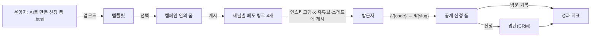

# 사용 가이드

리드마그넷 CRM으로 캠페인을 열고, 채널별 링크를 배포하고, 신청자와 성과를 확인하는 방법이다. 실행 방법은 [README](../README.md), 설계 배경은 [OVERVIEW](OVERVIEW.md)를 본다.

## 1. 한눈에 보기

| 화면 | 주소 | 누가 |
|---|---|---|
| 관리자 화면 | http://localhost:5173 | 운영자(로그인 필요) |
| 공개 신청 폼 | http://localhost:8081/f/{slug} | 방문자(로그인 없음) |
| 배포 링크 | http://localhost:8081/l/{code} | 방문자가 SNS에서 누르는 주소 |
| API 문서 | http://localhost:8080/swagger-ui.html | 개발자 |

## 2. 운영자 사용법

### 2.1 로그인

1. http://localhost:5173 에 접속한다.
2. `.env`의 `ADMIN_SEED_EMAIL`, `ADMIN_SEED_PASSWORD`로 로그인한다.
3. 로그인 상태는 브라우저 메모리에만 있다. 새로고침하면 refresh 쿠키로 자동 복원되고, 로그아웃하거나 14일 동안 쓰지 않으면 다시 로그인해야 한다.

### 2.2 신청 폼 HTML 준비하기 (AI에게 만들게 할 때)

업로드할 파일은 **단일 `.html`(또는 `.htm`) 파일**이다. AI에게 요청할 때 아래 조건을 함께 주면 한 번에 통과한다([ADR 0004](adr/0004-html-form-contract.md)).

- `<form>`은 **정확히 하나**.
- 입력에는 `name` 속성을 붙인다. 이름은 영문자로 시작하고 영문·숫자·`_`만, 50자 이하, 필드는 최대 50개.
- **연락처 필드 필수**: `name="phone"`(전화번호, 텍스트·tel 입력) 또는 `name="email"`(이메일 입력) 중 하나 이상. 이름은 `name="name"`으로 두면 명단의 이름 칸에 들어간다.
- 쓰면 안 되는 입력: `type="file"`, `type="password"`.
- 크기 512KB 이하, UTF-8.
- 스크립트·스타일은 써도 된다(공개 폼에서 sandbox 안에서 돈다). 단 **외부 이미지·웹폰트·외부 CSS는 공개 폼에서 표시되지 않는다**(보안 정책, [ADR 0002](adr/0002-html-isolation.md)). 이미지는 `data:` URI로 넣는다.
- 개인정보 수집 동의 문구는 HTML에 넣지 않아도 된다. 폼을 만들 때 관리자 화면에서 입력하면 공개 폼 아래에 동의 체크박스로 붙는다.

AI 요청 예시(짧은 버전):

> 리드 수집용 신청 폼을 단일 HTML 파일로 만들어 줘. form은 하나만, 입력 name은 name, phone, email, company_size(select), interests(checkbox 여러 개), memo(textarea). 외부 CDN·웹폰트·외부 이미지는 쓰지 말고 CSS는 style 태그 안에. 제출 버튼은 form 안의 submit 버튼.

**규칙을 빠짐없이 담은 프롬프트는 [AI_FORM_PROMPT.md](AI_FORM_PROMPT.md)에 있다.** 관리자 화면 **템플릿** 목록의 **AI 프롬프트 복사** 버튼으로 같은 글을 복사해 AI에게 붙여 넣고, 원하는 디자인·문구를 이어서 적는다. 규칙별 검사 코드 대응표와 경고 없이 통과하는 예시도 그 문서에 있다.

### 2.3 템플릿 업로드

1. 왼쪽 메뉴 **템플릿** → **HTML 업로드**.
2. 파일을 끌어다 놓거나 선택하고, 이름(선택)을 입력해 업로드한다.
3. 상세 화면에서 **추출된 필드 표**(이름·유형·필수·라벨·선택지)를 확인한다. 이 표가 신청 데이터 검증 기준이 된다.
4. 오른쪽 미리보기는 관리자 화면에서 **스크립트 없이 정적으로** 보인다(보안). 스크립트 동작은 폼을 게시한 뒤 공개 URL에서 확인한다.

#### 검사 리포트 (경고 확인하기)

공개 폼은 외부 이미지·웹폰트·외부 CSS·외부 스크립트를 막기 때문에, 그런 HTML은 업로드는 되지만 화면이 다르게 보인다. 업로드 때 이를 미리 알려 준다([ADR 0017](adr/0017-template-inspection.md)).

- 업로드 다이얼로그에서 파일을 고르고 **검사만 하기**를 누르면 **아무것도 저장하지 않고** 추출될 필드와 검사 결과만 보여 준다. 고쳐서 다시 검사해 보다가 마음에 들면 **업로드**한다.
- 업로드하면 템플릿 상세의 **검사 결과**에 **경고**(공개 폼에서 문제가 될 수 있는 것)와 **참고**(알아 두면 되는 것)가 나뉘어 보인다. 경고가 있어도 업로드는 된다. 오류(`<form>` 개수, 연락처 필드 없음 등)만 업로드를 막는다.
- 경고마다 설명, 코드, 위치가 나온다. 한 코드의 경고가 20건을 넘으면 "외 N건"으로 줄여 보여 준다. 코드별 뜻과 고치는 법은 [TROUBLESHOOTING 3.1절](TROUBLESHOOTING.md#31-검사-경고-업로드는-되지만-확인이-필요한-것)에 있다.
- 이 기능 이전에 올린 템플릿도 상세를 열면 검사 결과가 계산되어 보인다.

#### 새 버전 올리기 (템플릿 고치기)

템플릿 상세의 **새 버전 업로드**로 같은 템플릿에 수정한 HTML을 올린다([ADR 0018](adr/0018-publish-snapshot.md)). 업로드와 같은 검사를 하고, 통과하면 내용·필드·검사 결과가 바뀌고 버전이 올라간다. 템플릿 목록과 상세에 **버전**과 **수정일**이 보인다.

- **초안 폼**은 새 필드로 다시 만들어진다. 직접 바꾼 라벨·필수 여부는 같은 이름의 필드에서 유지된다. 결과 화면이 "다시 만든 초안 폼 N개"를 알려 준다.
- **게시했거나 마감한 폼은 바뀌지 않는다.** 폼은 게시하는 순간의 HTML과 필드를 복사해 두고 공개 화면과 신청 검증에 그것만 쓴다. 새 버전을 공개 폼에 반영하려면 새 폼을 만들어 게시한다.
- 게시한 폼의 패널에 **"게시 시점 템플릿과 현재 템플릿이 다릅니다"**가 보이면, 게시한 뒤 템플릿에 새 버전이 올라온 것이다. 그 폼은 게시 당시 내용 그대로 공개되고 있다.

### 2.4 캠페인과 폼 만들기

1. **캠페인** → **새 캠페인**: 이름, 설명, 기간(선택). 기간은 참고용이며 폼을 자동으로 열고 닫지 않는다.
2. 캠페인 상세 → **폼** 탭 → **새 폼**: 템플릿, 제목, 동의 문구, slug(선택, 비우면 자동 생성).
3. 폼은 **초안 → 게시됨 → 마감** 순서로만 바뀐다. 제목·동의 문구·필드 설정(라벨, 필수 여부)은 **초안에서만** 고칠 수 있다.
4. **게시**하면 그 시점의 템플릿 HTML과 필드가 폼에 복사되고 공개 URL `http://localhost:8081/f/{slug}`가 열린다. 마감하면 같은 주소가 "마감된 신청입니다"(410)로 바뀐다.
5. 캠페인을 **보관**하면 새 폼을 만들 수 없다.

### 2.5 채널별 배포 링크

1. 폼 행을 펼쳐 **배포 링크**에서 채널별로 **링크 만들기**를 누른다(인스타그램, X, 유튜브, 스레드 각 1개).
2. `http://localhost:8081/l/{code}` 형식의 짧은 주소를 **복사**해 해당 SNS 게시물·프로필·설명란에 붙인다.
3. 방문자가 링크를 누르면 공개 폼으로 이동하고, 그 방문과 신청은 해당 채널로 집계된다. 링크 없이 공개 URL로 바로 들어온 방문은 **직접 유입**이다.

### 2.6 성과 보기

캠페인 상세 → **성과** 탭.

| 지표 | 뜻 |
|---|---|
| 방문 | 공개 폼 페이지가 열린 횟수 |
| 방문자 | 고유 방문자 수(브라우저 쿠키 기준) |
| 신청 | 신청 건수 |
| 전환 방문자 | 기간 안에 방문도 하고 신청도 한 방문자 수 |
| 전환율 | 전환 방문자 ÷ 방문자 |

- 기간은 서울 시간 날짜 기준이다. 비우면 전체 기간.
- 링크 미리보기 크롤러·검색 봇·스크립트의 방문(User-Agent 기준)은 방문·방문자·전환에 넣지 않는다([ADR 0019](adr/0019-data-quality-defense.md)). 신청 수는 그대로다.
- 채널별 표는 같은 채널 안에서 계산한다. 인스타그램으로 왔다가 나중에 직접 들어와 신청한 사람은 직접 유입 쪽 전환으로만 잡힌다([ADR 0005](adr/0005-metrics-definition.md)).
- **크리에이터별** 표는 2.8절을 본다.

### 2.8 크리에이터별 성과 (수익 배분 정산 근거)

크리에이터와 수익 배분(R/S)으로 협업할 때 "누가 방문자와 신청을 몇 명 데려왔는지"를 증명하는 기능이다([ADR 0014](adr/0014-creator-attribution.md)).

1. 왼쪽 메뉴 **크리에이터** → **새 크리에이터**: 이름(필수), 핸들(예: `@sky_kim`), 메모(정산 조건 등)를 입력한다. 상세 화면에서 **수정**, **보관**할 수 있다.
2. 캠페인 상세 → **폼** 탭 → 폼 행을 펼쳐 **크리에이터별 배포 링크**에서 크리에이터를 골라 **표에 추가**한 뒤, 채널 칸의 **만들기**를 누른다. 링크는 폼 × 채널 × 크리에이터마다 하나다. 위의 **배포 링크 (크리에이터 없음)** 표는 운영자 자체 링크다.
3. 크리에이터에게 그 크리에이터 행의 링크만 전달한다. 방문과 신청은 링크로 크리에이터가 정해진다.
4. 캠페인 **성과** 탭 아래 **크리에이터별** 표에서 크리에이터마다 방문·방문자·신청·전환 방문자·전환율을 본다. 마지막 **직접·자체 링크** 행은 크리에이터를 지정하지 않은 링크와 링크 없이 들어온 방문을 합친 값이다. 행 앞의 **+**를 누르면 채널별로 펼쳐진다.
5. 크리에이터 상세 화면에서는 그 크리에이터의 **캠페인별 성과**를 기간을 정해 본다(정산 보고용).

- 전환 방문자는 **같은 크리에이터의 링크로 방문하고 신청한 사람**이다. 같은 크리에이터라면 채널이 달라도 된다(유튜브 링크로 보고 인스타그램 링크로 신청). 다른 크리에이터의 링크로 신청했다면 어느 쪽에서도 전환이 아니다.
- 크리에이터 행을 더한 값은 캠페인 전체와 다를 수 있다(여러 크리에이터 링크를 오간 방문자). 행끼리 더하지 않는다.
- 크리에이터를 **보관**하면 새 링크를 만들 수 없지만 이미 배포한 링크는 계속 동작하고 성과도 남는다.

### 2.7 명단 보기

캠페인 상세 → **명단** 탭에서 신청자(이름, 전화번호, 이메일, 채널, 폼, 추가 항목)를 최신순으로 본다. 폼·채널로 거를 수 있고 20건씩 넘긴다. 같은 폼에 같은 전화번호나 이메일로 다시 신청하면 저장되지 않는다([ADR 0007](adr/0007-duplicate-submission.md)).

- 이름·전화번호·이메일은 **가려서** 보인다: `홍*동`, `010-****-5678`, `h***@example.com`(두 글자 이름은 `에*`, 한 글자는 `*`).
- 연락이 필요한 신청자만 그 줄의 **원문 보기**를 누른다. 그 줄에만 원문이 보이고, **가리기**를 누르거나 다른 페이지·필터·화면으로 옮기면 다시 가려진다.
- 연락처를 읽을 수 없는 줄(데이터 손상)은 "복호화 불가"로 표시되고 원문 보기가 없다. 문제 해결 문서를 본다.
- 신청자 정보는 DB에 암호화되어 저장된다([ADR 0015](adr/0015-pii-encryption.md)). 화면에 원문을 띄워 둔 채 자리를 비우지 않는다.
- **CSV 다운로드**: 명단 탭 오른쪽의 **CSV 다운로드** 메뉴에서 고른다. 지금 화면의 폼·채널 필터가 그대로 적용되고, 페이지와 상관없이 조건에 맞는 전체가 신청 순으로 담긴다. 엑셀에서 바로 열린다(UTF-8 BOM).
  - **마스킹**: 화면과 같은 가린 값. 공유·보고용으로 쓴다.
  - **원문**: 이름·전화번호(숫자만)·이메일 원문. 확인 대화상자를 거치며, 다운로드는 감사 로그에 기록된다. 다 쓴 파일은 지운다.
  - 열: 신청일, 이름, 전화번호, 이메일, 채널, 크리에이터, 폼, 추가 항목(JSON). `=`·`+`·`-`·`@`로 시작하는 값(앞 공백 무시)은 엑셀이 수식으로 실행하지 않도록 앞에 `'`가 붙고, 셀에 그대로 보인다.
- 명단 조회, 원문 보기, CSV 다운로드는 모두 [감사 로그](#29-감사-로그)에 남는다.

### 2.9 감사 로그

사이드바 **감사 로그**에서 누가 언제 신청자 정보를 봤는지 확인한다([ADR 0016](adr/0016-audit-log.md)).

- 기록되는 행동: 명단 조회, 원문 열람(어느 신청), CSV 다운로드(마스킹·원문, 건수), 로그인 성공·실패(실패는 가린 이메일).
- 행동·캠페인·기간(서울 날짜, 양 끝 포함)으로 거르고 최신순으로 20건씩 넘긴다. 브라우저 열에 User-Agent 앞부분이 보이고, 눌러서 펼치면 전체가 보인다(키보드로도 열 수 있다).
- 기록은 수정·삭제할 수 없고 신청자 원문 개인정보는 담지 않는다.
- 감사 기록을 저장하지 못하면 원문 보기와 CSV 다운로드는 실패한다(원문을 기록 없이 내주지 않는다). 명단 조회와 로그인은 그대로 된다.

## 3. 방문자 경험

1. SNS의 링크를 누르면 공개 폼이 열린다.
2. 운영자가 올린 폼에 입력하고, 아래 **동의 체크박스**를 체크한 뒤 폼의 제출 버튼을 누른다.
3. 결과(접수 완료 또는 고칠 항목)가 폼 아래에 표시된다.

방문자의 입력은 래퍼가 한 번, 서버가 다시 한 번 검증한다. 업로드 HTML은 관리자 로그인 정보나 관리자 API에 접근할 수 없다(브라우저 E2E로 확인: [docs/e2e](e2e/results.json)).

스팸 방지([ADR 0019](adr/0019-data-quality-defense.md)): 폼을 연 지 2초가 안 돼 제출하면 "잠시 후 다시 제출해 주세요"가 보인다. 그대로 다시 제출하면 된다. 같은 기기·네트워크에서 1분 안에 여러 번 제출하면 잠시 막힌다(같은 방문자 분당 5회, 같은 IP 분당 10회). 사람에게 보이지 않는 칸을 채운 봇의 제출은 접수된 것처럼 보이지만 저장하지 않는다.

## 4. 유스케이스

### UC-1. 크리에이터 무료 가이드 신청 받기

- **상황**: 인스타그램 크리에이터와 함께 "마케팅 자동화 무료 가이드"를 배포하고 신청자 연락처를 모은다.
- **흐름**: AI로 신청 폼 HTML 생성 → 템플릿 업로드 → 캠페인 "가을 가이드" 생성 → 폼 생성·게시 → 인스타그램 링크 생성 → 크리에이터 프로필 링크에 등록 → 명단에서 신청자 확인.
- **결과**: 신청자마다 이름·연락처·관심 주제가 명단에 쌓이고 채널은 인스타그램으로 표시된다.

### UC-2. 채널별 성과 비교

- **상황**: 같은 폼을 인스타그램·X·유튜브·스레드에 동시에 배포하고 어느 채널이 효율적인지 본다.
- **흐름**: 폼 하나에 채널 링크 4개 생성 → 채널마다 해당 링크 게시 → 며칠 후 성과 탭의 채널별 표 확인.
- **결과**: 채널마다 방문·방문자·신청·전환율을 비교한다. 예: 유튜브는 방문은 많지만 전환율이 낮고, 스레드는 방문이 적어도 전환율이 높다.

### UC-3. 기간을 정한 이벤트 마감

- **상황**: 선착순 신청을 받다가 마감한다.
- **흐름**: 폼 탭에서 **마감**(확인 다이얼로그) → 공개 URL과 배포 링크가 "마감된 신청입니다" 안내로 바뀐다.
- **결과**: 마감 후 신청은 들어오지 않고, 그때까지의 명단과 지표는 그대로 남는다.

### UC-4. 같은 사람의 중복 신청

- **상황**: 한 사람이 같은 폼에 두 번 신청한다.
- **결과**: 두 번째는 "이미 신청한 연락처입니다"(409)로 거절되고 명단에는 한 건만 남는다. 지표의 신청 수도 한 건이다.

### UC-5. 특정 기간 성과 보고

- **상황**: 지난주 성과만 보고해야 한다.
- **흐름**: 성과 탭에서 시작일·종료일 지정 → KPI와 채널별 표가 그 기간으로 다시 계산된다.

### UC-6. 크리에이터 두 명과 수익 배분 정산

- **상황**: 같은 무료 가이드 폼을 크리에이터 김하늘(인스타그램·유튜브)과 박바다(인스타그램)가 함께 홍보하고, 월말에 신청 수 기준으로 수익을 나눈다.
- **흐름**: 크리에이터 두 명 등록 → 폼 탭의 크리에이터별 배포 링크에서 김하늘 인스타그램·유튜브, 박바다 인스타그램 링크 생성 → 각자 자기 링크만 게시 → 월말에 성과 탭의 기간을 그 달로 지정하고 **크리에이터별** 표 확인(또는 크리에이터 상세의 캠페인별 성과).
- **결과**: 같은 인스타그램 채널이어도 크리에이터별로 방문자·신청·전환이 나뉜다. 김하늘의 유튜브로 보고 인스타그램 링크로 신청한 사람은 김하늘의 전환으로 잡히고, 운영자 자체 링크나 직접 들어온 신청은 **직접·자체 링크** 행에 따로 남아 정산 대상에서 빠진다.

### UC-7. 개인정보 열람 점검

- **상황**: 분기마다 누가 신청자 원문을 보거나 내려받았는지 점검한다. 또는 운영자 계정이 탈취된 것 같다.
- **흐름**: 감사 로그 → 행동을 **원문 열람** 또는 **CSV 다운로드(원문)**으로, 기간을 점검 기간으로 지정 → 운영자·시각·IP·캠페인·건수 확인. 계정 탈취가 의심되면 **로그인 실패**·**로그인 성공** 기록의 IP와 시각도 함께 본다.
- **결과**: 어느 운영자가 어느 캠페인의 신청 몇 건을 언제 어디서 원문으로 봤는지 목록으로 남는다. 필요하면 해당 신청자에게 열람 사실을 안내하고 비밀번호를 바꾼다.

## 5. 더 보기

- 문제가 생기면: [TROUBLESHOOTING.md](TROUBLESHOOTING.md)
- 진행 현황과 다음 작업: [WORKPLAN.md](WORKPLAN.md)
- API 명세: [api/openapi.yaml](api/openapi.yaml) 또는 http://localhost:8080/swagger-ui.html
- 결정 기록: [adr/](adr/README.md)
