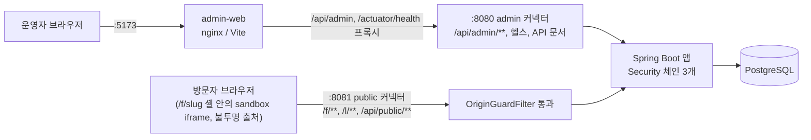

# 리드마그넷 CRM 운영 시스템 개요

이 시스템을 처음 읽는 사람을 위한 문서다. 실행·테스트 방법은 [README](../README.md), 계획과 결정 이유는 [PLAN](PLAN.md)과 [ADR](adr/README.md), API는 [docs/api/openapi.yaml](api/openapi.yaml)에 있다.

## 1. 무엇을 만들었나

운영자가 AI로 만든 단일 HTML 폼을 등록하면, 그 HTML로 캠페인의 공개 신청 폼을 만들고 인스타그램·X·유튜브·스레드용 배포 링크를 발급한다. 방문자는 공개 폼에서 신청하고, 신청은 CRM 명단(PostgreSQL)에 쌓인다. 운영자는 캠페인별, 채널별로 방문·방문자·신청·전환 방문자·전환율을 본다. 이 시스템을 크리에이터 트래픽을 리드로 바꾸고 그 리드가 어느 채널에서 왔는지 증명하는 내부 매출 인프라로 이해했다. 이제 시스템은 신청이 어느 채널과 어느 크리에이터에서 왔는지까지 증명한다(v0.2.0). v0.3.0은 운영 보안을 다졌다: 로그인 대입 제한, 프록시 뒤 실제 클라이언트 IP, payload 연락처 마스킹, 운영 행위 감사의 공백 메우기. v0.4.0은 운영 복원력을 더했다: 재시작과 여러 인스턴스에서도 유지되는 DB 기반 로그인 제한, `/refresh` 제한, 서비스를 멈추지 않는 개인정보 키 교체. CRM이라 보안을 기능이 아니라 구조로 다뤘다. 출처(포트)와 필터 체인으로 영역을 나눴고 업로드 HTML은 sandbox iframe으로 권한을 0으로 만들었다.

## 2. 아키텍처

앱은 하나(Spring Boot)이고 Tomcat 커넥터가 두 개다(ADR [0010](adr/0010-single-app-two-ports.md)).

- `OriginGuardFilter`가 Security 앞에서 포트와 경로가 맞지 않는 요청을 404로 막는다. Security 체인은 admin(Bearer JWT), public(permitAll, 인증 헤더 무시), 기본(헬스·문서 외 denyAll) 세 개다(ADR [0003](adr/0003-auth.md)).
- 관리자 화면은 브라우저 입장에서 admin-web 출처 하나만 보므로 refresh 쿠키(SameSite=Strict, Path=/api/admin/auth)가 그대로 동작한다.

## 3. 요청 흐름: 링크 → 방문 → 신청 → 지표

1. 운영자가 템플릿을 업로드하고(폼 계약 검사, 필드 추출, ADR [0004](adr/0004-html-form-contract.md)) 캠페인과 폼을 만들어 게시한다(ADR [0013](adr/0013-campaign-form-status.md)). 채널별 배포 링크를 만든다.
2. 방문자가 `/l/{code}`를 열면 방문자 쿠키(`lm_vid`)만 받고 `/f/{slug}?lm={code}`로 302된다. 이 단계에서는 방문을 기록하지 않는다(ADR [0006](adr/0006-channel-attribution.md)).
3. `/f/{slug}` 로드 1회가 방문 1건이다. 페이지는 고정 셸이고 래퍼 스크립트가 `/api/public/forms/{slug}`로 HTML을 받아 sandbox iframe에 넣는다(ADR [0002](adr/0002-html-isolation.md)).
4. iframe은 입력을 postMessage로 래퍼에 넘기고, 래퍼가 검증한 뒤 `POST /api/public/forms/{slug}/submissions`로 보낸다. 서버가 동의와 필드 설정을 다시 검증하고 중복을 막는다(ADR [0007](adr/0007-duplicate-submission.md), [0008](adr/0008-lead-data-storage.md)). 신청은 방문 때 정해진 채널로 귀속된다.
5. 운영자가 캠페인 통계와 채널별 통계, 명단을 조회한다.

## 4. 보안 설계 요약

| 위협 | 대응 | 증명하는 테스트 |
|---|---|---|
| 미인증으로 관리자 API 접근, 만료·위조 토큰 | admin 체인 Bearer JWT, 서명·exp·iss·aud 검증 | `AdminResourceServerTest`, `AuthApiTest` |
| refresh token 탈취·재사용 | 사용마다 교체, 재사용 시 패밀리 전체 폐기, DB에는 해시만 저장 | `AuthApiTest`, `RefreshTokenTest` |
| 공개 출처에서 관리자 API 접근 | public 포트는 공개 경로만, 나머지 404 (OriginGuardFilter) | `PublicOriginIsolationTest`, `IsolationScenarioTest` |
| 다른 출처의 CORS 요청 | 관리자 API CORS는 `ADMIN_ORIGIN`만 허용 | `AdminCorsTest`, `PublicOriginIsolationTest` |
| 업로드 HTML이 관리자 자격 증명에 접근 | sandbox iframe(`allow-same-origin` 금지)로만 렌더링, 쿠키·DOM 접근 불가 | `PublicOriginIsolationTest`(`래퍼_셸은_allow_same_origin_없이_샌드박스_iframe만_쓴다`), `IsolationScenarioTest`, `TemplateDetail.test.tsx`(admin-web 미리보기) |
| 업로드 HTML이 방문자 입력을 외부로 전송 | CSP `default-src 'none'`, `connect-src 'self'`, `form-action 'none'`, 이미지·스타일·폰트는 `'self'`/`data:`만 (ADR 0002 변경 기록) | `PublicOriginIsolationTest`(CSP 값을 정확히 비교) |
| 래퍼 우회 제출(sandbox에서 직접 호출) | 서버가 신뢰 경계: JSON만, `Origin: null`은 403, 동의·필드 검증 | `LeadSubmissionApiTest`, `SubmissionValidatorTest` |
| NUL·제어 문자 입력 | 422로 거부(500·로그 오염 방지) | `TextInputTest`, `LeadSubmissionApiTest` |
| 중복 신청, 전화번호가 DB 오류 로그에 실리는 문제 | V4 해시 부분 유니크 인덱스(`(form_id, phone_hash)`, `(form_id, email_hash)`) + 대상 없는 `ON CONFLICT DO NOTHING`, 409. 평문 컬럼과 V2 평문 인덱스는 V5에서 삭제 | `LeadSubmissionApiTest`, `SchemaMigrationTest` |
| 개인정보가 로그에 남음 | `PiiMasker`, 원문 미기록 | `PiiMaskerTest`, `LeadSubmissionApiTest`(로그 캡처) |
| DB 덤프·백업 유출로 연락처 노출 | 이름·전화·이메일은 AES-256-GCM(컬럼 이름을 AAD로 묶음)으로만 저장, 중복 판정은 HMAC-SHA256 해시. 기동 시 `pii_key_check`로 키가 기존 데이터와 같은지 확인하고 다르면 기동 중단 (ADR 0015). 키 교체: 암호문 형식 2(키 id), 이전 키는 읽기 전용, `POST /api/admin/pii/reencrypt`로 재암호화, HMAC은 `LEAD_HMAC_PREVIOUS_KEY`를 둔 채 기동하면 요청 전에 해시를 다시 계산 (ADR 0022) | `PiiCipherTest`, `PiiHasherTest`, `PiiKeyCheckTest`, `PiiContractGuardTest`, `PiiReencryptApiTest`, `LeadHmacRotationTest`, `PiiDefaultKeyConfigTest` |
| 운영자 화면·API·CSV로 연락처가 무분별하게 노출 | 명단은 가린 값만, 원문은 한 건씩 `GET /api/admin/leads/{id}/contact`와 `reveal=true` CSV로만. 원문을 내주는 쪽은 감사 로그를 쓰지 못하면 요청도 실패(`recordRequired`) (ADR 0016) | `LeadContactApiTest`, `LeadListApiTest`, `LeadExportApiTest`, `AuditLogApiTest`, `AuditFailurePolicyTest` |
| 스팸 신청, 봇 방문이 지표를 왜곡 | 작성 시간 토큰 `ft`(2초~24시간), honeypot `_lm_trap`, IP·방문자 rate limit(429), 봇 UA 방문은 `is_bot`으로 남기고 지표에서 제외. 검사 순서는 고정 (ADR 0019) | `FormTokenTest`, `LeadSubmissionApiTest`, `SubmissionRateLimitTest`, `RateLimiterTest`, `BotUserAgentsTest`, `VisitTrackingTest` |
| 수집 목적이 끝난 개인정보가 계속 남음 | 캠페인 보존 기간(기본 365일)이 지난 신청을 익명화(암호문·해시 NULL, payload는 키만). 배치마다 advisory lock, 실행마다 감사 기록, 동의 문구 증빙은 남김 (ADR 0020) | `LeadRetentionApiTest`, `LeadRetentionFailureTest`, `RetentionSchedulerTest`, `RetentionConsentMigrationTest` |
| CSV를 열면 스프레드시트가 신청자 입력을 수식으로 실행 | 앞 공백을 건너뛴 첫 글자가 `=`, `+`, `-`, `@`이거나 탭·CR로 시작하면 `'`를 붙임(`common/Csv`) (ADR 0016) | `CsvTest`, `LeadExportApiTest` |
| 클릭재킹, `<base>` 주입 | `frame-ancestors 'none'`, `X-Frame-Options: DENY`, `base-uri 'none'` | `PublicOriginIsolationTest` |
| 에러 응답으로 정보 노출 | 404/ProblemDetail 통일, 401·403도 같은 형식 | `ProblemDetailContractTest`, `ProblemDetailsTest` |
| 관리자 화면이 업로드 HTML 미리보기에서 오염 | 미리보기도 같은 sandbox 컴포넌트 하나로만, CSP를 admin-web에도 적용 | `csp.test.ts`, `TemplateDetail.test.tsx`(admin-web) |
| 로그인 비밀번호 대입 | `LoginThrottle` 슬라이딩 윈도: (이메일, IP) 15분 5회, 이메일 50회, IP 20회 실패 시 429 `too_many_login_attempts` + `Retry-After`. 성공하면 해당 쌍을 비운다. 기록은 DB `login_failures`(V13, HMAC 키만 저장)에 두고 advisory lock으로 자리를 잡아 서버 여러 대가 공유하며 재시작해도 남는다. `/refresh`는 IP별 분당 30회(429 `too_many_requests`, 인메모리·인스턴스별) (ADR 0021) | `LoginThrottleApiTest`, `LoginThrottleTest`, `LoginFailureCleanupTest`, `RefreshRateLimitApiTest` |
| 프록시 뒤 IP 위조, 감사·rate limit이 프록시 IP만 봄 | `ClientIpFilter`가 `TRUSTED_PROXIES`(기본 admin-web 고정 주소 `172.16.57.10/32`)에서 온 admin 요청의 `X-Forwarded-For`만 오른쪽부터 읽는다. public 포트는 XFF를 읽지 않는다. :8080·:5432는 호스트 루프백에만 연다 | `ClientIpTest`, `ClientIpFilterTest`, `TrustedProxiesTest` |
| payload에 평문으로 남는 전화·이메일 모양 항목 | 업로드 검사의 `extra_contact_field` 경고, 명단과 마스킹 CSV에서 `extraContacts`를 같은 규칙으로 가림, 원문은 reveal API·원문 CSV로만(감사 필수). 암호화는 아니다 | `ExtraContactsTest`, `LeadListApiTest`, `LeadContactApiTest`, `LeadExportApiTest` |

## 5. 지표 정의

방문은 `/f/{slug}` 로드 1회, 방문자는 `visitor_id`의 고유 수, 신청은 `leads` 행 수, 전환율은 방문과 신청 양쪽에 있는 방문자 수 ÷ 방문자 수(분모 0이면 0)다. 날짜는 Asia/Seoul 기준이고 채널별 전환은 같은 채널 안의 교집합이다. 봇 UA로 들어온 방문(`visits.is_bot`)은 모든 지표에서 제외한다(ADR [0019](adr/0019-data-quality-defense.md)). 크리에이터별 지표도 있다: 링크의 `creator_id`로 귀속하고 `COALESCE(creator_id, 0)`을 키로 쓰며 0은 "직접·자체 링크"다(ADR [0014](adr/0014-creator-attribution.md)). 정의 전문과 알려진 한계는 ADR [0005](adr/0005-metrics-definition.md)에 있고 `StatsQuery` SQL 주석에 그대로 인용되어 있다.

## 6. 모호한 요구와 가정

| 모호한 지점 | 가정 | ADR |
|---|---|---|
| 업로드 HTML을 어떻게 안전하게 보여줄까 | sandbox iframe + postMessage + CSP, 스크립트는 지우지 않음 | [0002](adr/0002-html-isolation.md) |
| 인증 방식과 토큰 수명 | 자체 발급 JWT 15분 + refresh 14일 교체·재사용 감지 | [0003](adr/0003-auth.md) |
| "단일 HTML 폼"의 최소 계약 | form 1개, 연락처(phone 또는 email) 필수, file·password 금지 | [0004](adr/0004-html-form-contract.md) |
| 전환율의 정의 | 방문자 교집합 기반, 서울 시간대 | [0005](adr/0005-metrics-definition.md) |
| 채널 귀속 | `lm` 코드로 방문 시 귀속, 직접 접근은 `direct` | [0006](adr/0006-channel-attribution.md) |
| 중복 신청 | 같은 폼의 같은 phone/email은 409 | [0007](adr/0007-duplicate-submission.md) |
| 신청 데이터 저장 | 연락처 컬럼 + 나머지는 jsonb | [0008](adr/0008-lead-data-storage.md) |
| 운영자 계정은 어떻게 만드나 | 기동 시 환경 변수 시드 | [0009](adr/0009-operator-seed.md) |
| 출처 분리 방식 | 앱 하나, 포트 두 개 | [0010](adr/0010-single-app-two-ports.md) |
| 관리자 UI 구성 | React SPA, 메모리 토큰, URL 쿼리 상태 | [0011](adr/0011-admin-ui.md) |
| 폼·캠페인 상태 | draft → published → closed, 게시 후 필드 고정 | [0013](adr/0013-campaign-form-status.md) |
| 크리에이터 귀속 | 링크의 `creator_id`(NULL = 자체 링크), 지표 키는 `COALESCE(creator_id, 0)` | [0014](adr/0014-creator-attribution.md) |
| 개인정보 보관 | AES-GCM + AAD, HMAC 중복 판정, 마스킹 목록, 원문은 한 건씩, expand → contract | [0015](adr/0015-pii-encryption.md) |
| 열람·다운로드 추적 | 감사 로그(필수/최선 노력 구분), CSV는 수식 방지 | [0016](adr/0016-audit-log.md) |
| 업로드 HTML 점검 | 막지 않고 경고만 | [0017](adr/0017-template-inspection.md) |
| 게시 후 템플릿 변경 | 게시 시점 스냅샷, 템플릿 → 폼 순서 락 | [0018](adr/0018-publish-snapshot.md) |
| 스팸·봇 | 봇 플래그, `ft` 토큰, honeypot, 429, 고정된 검사 순서 | [0019](adr/0019-data-quality-defense.md) |
| 보존 기간 파기와 동의 증빙 | 익명화(행·지표 유지), advisory lock, 동의 문구 복사 | [0020](adr/0020-retention-and-consent-evidence.md) |
| 로그인 시도 제한과 신뢰 프록시 | (이메일,IP)·이메일·IP 슬라이딩 윈도, admin 포트만 XFF, 고정 admin-web 주소 | [0021](adr/0021-login-throttle-and-trusted-proxy.md) |
| 기술 스택·브랜치 전략 | [0001](adr/0001-tech-stack.md), [0012](adr/0012-branch-environment.md) | |

## 7. 테스트 전략과 숫자

모든 기능에 성공·실패 케이스를 함께 둔다. backend는 Testcontainers의 실제 PostgreSQL(`postgres:17-alpine`)로 돌리고 H2를 쓰지 않는다.

| 대상 | 명령 | 결과 |
|---|---|---|
| backend | `cd backend && ./gradlew build -Dopenapi.verify=true` | 99개 테스트 클래스, 825개 테스트(실패 0, verify 모드에서 export 쓰기 테스트 1건은 건너뜀) |
| admin-web | `cd admin-web && npm test` | 18개 파일, 166개 테스트 통과 |

- 도메인 규칙은 Spring 없는 단위 테스트(`FormContractParserTest`, `SubmissionValidatorTest`, `MetricsTest` 등), API는 `@IntegrationTest` + RestAssured다.
- 시나리오 테스트(`HappyPathScenarioTest`, `FailureScenarioTest`, `IsolationScenarioTest`)는 두 포트를 오가며 로그인 → 업로드 → 배포 → 방문 → 신청 → 지표를 실제 HTTP로 잇고, 지표는 손계산 표와 정확히 비교한다.
- 이 저장소의 자동 테스트는 서버가 내려주는 셸·CSP·헤더까지만 검증하고, 브라우저 안의 iframe·postMessage 동작은 포함하지 않는다. 브라우저 E2E는 Playwright로 별도 수행하고(24단계 모두 통과, [docs/e2e/results.json](e2e/results.json)) 결과를 리포트로 남긴다. v0.3.0부터 같은 E2E를 GitHub Actions 워크플로(`.github/workflows/e2e.yml`)가 docker compose로 스택을 올려 실행하고, 결과는 아티팩트 `e2e-results`로 남는다.
- `OpenApiExportTest`가 `docs/api/openapi.yaml`을 앱에서 내보내고, CI는 `-Dopenapi.verify=true`로 커밋된 파일이 최신인지 확인한다. 문서에는 admin 계열과 공개 경로가 함께 들어 있고 공개 경로는 오퍼레이션 단위로 public 출처(:8081)를 server로 가리킨다. 파일은 하나다.

## 8. AI 활용 방식

AI(Claude Code)로 구현하되 사람이 정한 규칙 안에서 움직이도록 통제했다.

1. 계획: 먼저 [PLAN](PLAN.md)에 해석, 결정과 이유, 이슈 순서를 정하고 이슈별 plan brief를 만들었다.
2. 가드레일: [CLAUDE.md](../CLAUDE.md)의 보안 불변식(출처 격리, sandbox, 토큰 보관, 개인정보 로그 금지)과 작업·코드 규칙을 AI가 어기지 못하는 기준으로 두었다.
3. 구현: 이슈마다 TDD로 일하는 implementer 서브에이전트가 실패 테스트 → 구현 순서로 만들었다.
4. 리뷰: 이슈마다 독립된 reviewer 서브에이전트가 따로 검토했고, 지적 사항은 수정 라운드를 거쳐 반영했다.
5. 최종 검토: 백엔드 전체를 한 번에 본 리뷰에서 릴리스 차단 이슈 3건이 나와 고쳤다.
   - NUL 문자 입력이 500이 되고 오류 로그에 다른 개인정보까지 실리는 문제 → 422로 거부
   - `value` 없는 체크박스·라디오 때문에 신청을 하나도 받지 못하는 폼 → 브라우저 기본값 `on`을 받음
   - CSP가 이미지·폰트·스타일의 외부 `https:`를 허용해 입력이 GET URL로 새는 경로 → 허용 제거(ADR 0002 변경 기록)

PR(저장소 https://github.com/kimcno3/lead-magnet-crm):

| PR | 내용 |
|---|---|
| [#20](https://github.com/kimcno3/lead-magnet-crm/pull/20) | 저장소 골격과 로컬 실행 환경 |
| [#21](https://github.com/kimcno3/lead-magnet-crm/pull/21) | Flyway 스키마, 프로필, 운영자 시드 |
| [#22](https://github.com/kimcno3/lead-magnet-crm/pull/22) | 인증(JWT, refresh 교체·재사용 감지) |
| [#23](https://github.com/kimcno3/lead-magnet-crm/pull/23) | HTML 템플릿 업로드와 폼 계약 |
| [#24](https://github.com/kimcno3/lead-magnet-crm/pull/24) | 캠페인·폼 |
| [#25](https://github.com/kimcno3/lead-magnet-crm/pull/25) | 배포 링크 |
| [#26](https://github.com/kimcno3/lead-magnet-crm/pull/26) | 공개 출처 격리와 방문 추적 |
| [#27](https://github.com/kimcno3/lead-magnet-crm/pull/27) | 신청 접수와 명단 |
| [#28](https://github.com/kimcno3/lead-magnet-crm/pull/28) | 성과 지표 |
| [#29](https://github.com/kimcno3/lead-magnet-crm/pull/29) | 성공·실패·격리 시나리오 테스트 |
| [#31](https://github.com/kimcno3/lead-magnet-crm/pull/31) | 최종 리뷰 반영 |
| [#32](https://github.com/kimcno3/lead-magnet-crm/pull/32) | 관리자 화면(admin-web) |
| [#33](https://github.com/kimcno3/lead-magnet-crm/pull/33) | ADR 정리, OVERVIEW, OpenAPI, README |
| [#36](https://github.com/kimcno3/lead-magnet-crm/pull/36) | 흑백 색상 체계 |
| [#37](https://github.com/kimcno3/lead-magnet-crm/pull/37) | Playwright 브라우저 E2E |
| [#39](https://github.com/kimcno3/lead-magnet-crm/pull/39) | 사용 가이드, 문제 해결, 작업 계획 |
| [#41](https://github.com/kimcno3/lead-magnet-crm/pull/41) | 크리에이터별 배포 링크와 성과 지표 |
| [#42](https://github.com/kimcno3/lead-magnet-crm/pull/42) | 신청자 개인정보 암호화와 명단 마스킹 (expand) |
| [#43](https://github.com/kimcno3/lead-magnet-crm/pull/43) | 평문 연락처 컬럼 삭제 (contract) |
| [#44](https://github.com/kimcno3/lead-magnet-crm/pull/44) | 명단 열람·다운로드 감사 로그와 CSV 다운로드 |
| [#45](https://github.com/kimcno3/lead-magnet-crm/pull/45) | 업로드 HTML 검사 리포트와 AI 프롬프트 가이드 |
| [#46](https://github.com/kimcno3/lead-magnet-crm/pull/46) | 게시 시 템플릿 스냅샷과 새 버전 업로드 |
| [#47](https://github.com/kimcno3/lead-magnet-crm/pull/47) | 봇 방문 제외, honeypot, 작성 시간 토큰, rate limit |
| [#48](https://github.com/kimcno3/lead-magnet-crm/pull/48) | 보존 기간 파기와 동의 문구 증빙 |
| [#50](https://github.com/kimcno3/lead-magnet-crm/pull/50) | v0.2.0 릴리스 준비: 문서, 최종 리뷰의 값싼 보강, E2E 갱신 |
| [#57](https://github.com/kimcno3/lead-magnet-crm/pull/57) | 로그인 시도 제한과 신뢰 프록시 뒤 실제 클라이언트 IP |
| [#58](https://github.com/kimcno3/lead-magnet-crm/pull/58) | payload의 연락처 모양 추가 항목 경고와 마스킹 |
| [#60](https://github.com/kimcno3/lead-magnet-crm/pull/60) | 운영자 행위 감사 공백 메우기 |
| [#59](https://github.com/kimcno3/lead-magnet-crm/pull/59) | Playwright 브라우저 E2E를 CI에 통합 |
| [#61](https://github.com/kimcno3/lead-magnet-crm/pull/61) | 크리에이터 `utm_content`와 패키지 의존 방향 정리 |
| [#63](https://github.com/kimcno3/lead-magnet-crm/pull/63) | v0.3.0 릴리스 준비: 문서, OpenAPI 버전, E2E 갱신 |
| [#68](https://github.com/kimcno3/lead-magnet-crm/pull/68) | 감사 액션 목록의 OpenAPI 생성과 새 감사 행의 IP 검증 |
| [#70](https://github.com/kimcno3/lead-magnet-crm/pull/70) | 로그인 시도 제한 공유 저장소(V13)와 `/refresh` 제한 |
| [#69](https://github.com/kimcno3/lead-magnet-crm/pull/69) | 개인정보 암호화·HMAC 키 교체 절차 |
| [#72](https://github.com/kimcno3/lead-magnet-crm/pull/72) | v0.4.0 릴리스 준비: 문서, OpenAPI 버전, E2E 갱신 |

## 9. 범위 밖과 로드맵

실제 AI 연동, 외부 CRM·문자·알림톡·광고 연동, 범용 폼 빌더, 결제는 범위 밖이다. 배포(Render·Neon), dev·prod 프로필, Authorization Server, 로그인 시도 제한의 공유 저장소, refresh 절대 수명, 웹훅, 멀티모듈 분리 등 남은 일은 [ROADMAP](ROADMAP.md)에 있고, 다음 릴리스 후보와 우선순위는 [WORKPLAN](WORKPLAN.md)에 있다.

## 10. v0.2.0 extras

v0.1.0 core 위에 회사의 사업 구조(크리에이터 성과형 협업, 개인정보를 다루는 CRM)에 직접 연결되는 7가지를 더했다. 기능마다 결정을 ADR로 남기고 성공·실패 테스트를 함께 두었다.

| 기능 | 핵심 결정 | ADR | 증명하는 테스트 |
|---|---|---|---|
| 크리에이터별 성과 | `creators` 테이블, 링크의 `creator_id`(NULL = 자체 링크)로 귀속, 방문·신청의 크리에이터는 `link_id`로 유도. 지표 키는 `COALESCE(creator_id, 0)`이고 0은 "직접·자체 링크". 폼 × 채널 × 크리에이터당 링크 하나 | [0014](adr/0014-creator-attribution.md) | `CreatorApiTest`, `CreatorTest`, `CreatorStatsApiTest`, `LinkServiceTest`, `DistributionLinkTest` |
| 개인정보 암호화 | AES-256-GCM(컬럼 이름을 AAD로 묶음) + 중복 판정용 HMAC-SHA256, 명단은 마스킹, 원문은 `GET /api/admin/leads/{id}/contact`로 한 건씩, 기동 시 `pii_key_check`로 키 일치 확인. expand(V4) → contract(V5) | [0015](adr/0015-pii-encryption.md) | `PiiCipherTest`, `PiiHasherTest`, `PiiKeyCheckTest`, `PiiContractGuardTest`, `LeadContactApiTest`, `LeadListApiTest`, `PiiMaskerTest` |
| 감사 로그와 CSV | 원문을 내주는 쪽은 감사 필수(`recordRequired`, 기록 실패 시 요청도 실패), 명단 조회·로그인은 최선 노력(`recordBestEffort`, 실패하면 WARN). CSV는 기록·범위 확정 뒤 keyset 스트리밍, 수식 시작 문자 앞에 `'`, 원문 전화번호는 하이픈 형식 | [0016](adr/0016-audit-log.md) | `AuditLogApiTest`, `AuditFailurePolicyTest`, `AuditActorTest`, `AuditActionTest`, `LeadExportApiTest`, `CsvTest`, `PhoneFormatTest` |
| 업로드 HTML 검사 | 업로드를 막지 않고 경고 `[{code, severity, message, location}]`만 낸다. 기존 행은 읽을 때 계산하고 저장하지 않는다 | [0017](adr/0017-template-inspection.md) | `TemplateInspectorTest`, `TemplateApiTest`, `AiFormPromptDocTest` |
| 게시 스냅샷 | 게시 시 템플릿 `content`·`sha256`을 폼에 복사하고 공개 API는 그것만 쓴다. 새 버전 업로드와 게시·폼 수정은 템플릿 행 → 폼 행 순서로 `PESSIMISTIC_WRITE` | [0018](adr/0018-publish-snapshot.md) | `PublishSnapshotConcurrencyTest`, `SnapshotBackfillTest`, `TemplateVersionApiTest`, `PublicFormApiTest` |
| 데이터 품질 방어 | `visits.is_bot`으로 봇 방문 제외, 제출은 `SubmissionGuardFilter`(403 → 413 → 429) → 404·410 → 작성 시간 토큰 `ft`(422) → honeypot `_lm_trap`(201, 저장 안 함) → 필드 검증. 이 순서는 고정 | [0019](adr/0019-data-quality-defense.md) | `BotUserAgentsTest`, `VisitTrackingTest`, `FormTokenTest`, `SubmissionRateLimitTest`, `RateLimiterTest`, `LeadSubmissionApiTest` |
| 보존 기간 파기와 동의 증빙 | `campaigns.retention_days`(기본 365)가 지난 신청을 익명화. 배치마다 `pg_try_advisory_xact_lock`, 실행마다 감사 한 줄, 신청 시 폼의 동의 문구와 해시를 복사해 증빙으로 남김 | [0020](adr/0020-retention-and-consent-evidence.md) | `LeadRetentionApiTest`, `LeadRetentionFailureTest`, `RetentionSchedulerTest`, `RetentionConsentMigrationTest`, `LeadTest` |

### 기능들이 맞물리는 방식

- 익명화는 암호문과 해시(`*_enc`, `*_hash`)를 지우지만 채널·링크·방문자 id·생성 시각 같은 지표용 값은 남긴다. 그래서 과거 지표와 크리에이터 성과는 그대로이고, 해시가 사라졌으니 같은 연락처의 재신청은 중복이 아니라 새 신청이 된다.
- 파기된 신청의 원문 API는 410 `lead_anonymized`를 돌려주고, CSV는 연락처 칸이 비고 마지막 열에 "파기됨"을 적는다.
- 보존 기간 변경(`campaign.retention.update`)과 파기 실행(`retention.anonymize`)은 감사 로그에 남는다.
- 동의 문구와 해시는 파기 뒤에도 남고, 동의 증빙 조회(`GET /api/admin/leads/{id}/consent`)는 파기된 신청에도 계속 열려 있다. 이 조회는 연락처를 내주지 않으므로 감사 기록을 쓰지 않는다.
- 봇 방문은 지표에서만 빠지고 방문 행은 남는다(`is_bot`). 제출 쪽 방어(토큰, honeypot, rate limit)는 신청 행이 만들어지기 전에 걸러진다.

### 마이그레이션 순서와 업그레이드

| 버전 | 내용 |
|---|---|
| V3 | `creators`, 링크의 `creator_id` |
| V4 | 암호문·해시 컬럼과 해시 부분 유니크 인덱스, `pii_key_check` (expand) |
| V5 | 평문 컬럼과 평문 인덱스 삭제 (contract). 맨 앞 `DO` 가드가 백필 안 된 행이 있으면 중단 |
| V6 | `audit_logs` |
| V7 | `html_templates.inspection` |
| V8 | 폼 게시 스냅샷 |
| V9 | `visits.is_bot` |
| V10 | `campaigns.retention_days`, `leads.anonymized_at`·`consent_text`·`consent_sha256` |
| V11 | `visits.link_id`, `leads.link_id` 인덱스 |

**v0.1.0에서 올릴 때.** V4와 V5가 한 번에 적용된다. v0.1.0 DB에 신청이 이미 있으면 V5의 가드가 중단시킨다(백필을 하던 러너(#42)가 이 버전에는 없기 때문이다). 길은 둘이다.

1. 데이터가 필요 없으면 새 DB로 시작한다: `docker compose down -v` 후 다시 `docker compose up --build`.
2. 데이터를 지키려면 커밋 `8b318db`(PR #42)를 체크아웃해 `docker compose up --build`로 한 번 기동한다. 기동 때 백필 러너가 기존 신청의 암호문·해시를 채운다. [ADR 0015](adr/0015-pii-encryption.md)의 게이트 쿼리가 `0`인지 확인한 뒤 v0.2.0을 체크아웃해 같은 `.env`(같은 키)로 `docker compose up --build` 한다(체크아웃마다 이미지를 다시 빌드해야 한다).

어느 쪽이든 키를 새로 만들어 `.env`에 넣어야 한다(아래). 길 2에서 키를 바꾸면 `pii_key_check`가 기동을 멈춘다.

### 필수 키 4개

`JWT_SECRET`(UTF-8 32바이트 이상), `LEAD_ENC_KEY`, `LEAD_HMAC_KEY`, `FORM_TOKEN_KEY`(셋 다 base64로 인코딩한 32바이트)를 모두 설정해야 하고, 서로 달라야 한다. 없거나 형식이 틀리거나 같으면 backend가 기동하지 않는다. 오류 메시지에는 키 값을 싣지 않는다. README의 `sed` 명령이 네 값을 한 번에 새로 만든다.

## 11. v0.3.0 hardening

v0.2.0 최종 리뷰에서 남은 높은 우선순위 위험(로그인 대입, 프록시 뒤 IP, payload의 평문 연락처)과 운영 공백(감사, CI의 E2E, 패키지 방향)을 닫았다. 새 기능이 아니라 운영 안전을 다지는 릴리스다.

| 기능 | 핵심 결정 | ADR | 증명하는 테스트 |
|---|---|---|---|
| 로그인 시도 제한과 실제 IP | (이메일, IP) 15분 5회·이메일 50회·IP 20회 실패의 슬라이딩 윈도(429 + `Retry-After`), 잠금 시작 때만 감사 한 줄(`auth.login.locked`). `ClientIpFilter`는 `TRUSTED_PROXIES`에서 온 admin 요청의 XFF만 읽고 public 포트는 읽지 않는다. compose 네트워크와 admin-web 주소 고정 | [0021](adr/0021-login-throttle-and-trusted-proxy.md) | `LoginThrottleApiTest`, `LoginThrottleTest`, `ClientIpTest`, `ClientIpFilterTest`, `TrustedProxiesTest` |
| 추가 연락처 항목 | `extra_contact_field` 경고, 명단·마스킹 CSV는 `extraContacts`를 가림, reveal API와 원문 CSV는 원문. 암호화하지 않는다 | [0015](adr/0015-pii-encryption.md) 변경 기록 | `ContactLikeFieldTest`, `ExtraContactsTest`, `LeadListApiTest`, `LeadExportApiTest`, `LeadContactApiTest` |
| 감사 공백 | 로그아웃, refresh 재사용 감지, 게시·마감, 템플릿 새 버전, 크리에이터 보관을 기록. 살아 있는 토큰을 실제로 폐기했을 때만 남긴다 | [0016](adr/0016-audit-log.md) 변경 기록 | `AuditGapsApiTest` |
| CI의 E2E | `.github/workflows/e2e.yml`이 compose 스택을 올려 Playwright 24단계를 실행 | (ADR 없음) | `e2e.yml` 워크플로 |
| `utm_content`와 계층 정리 | 크리에이터 링크의 `utm_content`(`creator-{id}`, V12가 기존 링크를 채움), `DateRange`·`AuditActor`·템플릿 새 버전 컨트롤러의 위치 정리 | [0014](adr/0014-creator-attribution.md) 변경 기록 | `CreatorUtmContentBackfillTest`, `PackageDependencyRulesTest` |

### 기능들이 맞물리는 방식

- 감사 로그의 IP와 로그인 제한의 IP는 둘 다 `ClientIpFilter`가 감싼 요청의 `getRemoteAddr()`에서 나온다. 감사 행위자(`AuditActors`)가 `X-Forwarded-For`를 직접 읽는 곳은 없으므로, 새 감사 행(`auth.logout`, `form.publish` 등)도 같은 규칙을 따른다.
- 로그아웃과 refresh 재사용 감지는 살아 있는 토큰을 실제로 폐기했을 때만 감사에 남는다. 죽은 토큰으로 엔드포인트를 두드려도 감사 테이블이 불어나지 않는다. 로그인 제한은 `/login`에만 걸리고 `/refresh`는 제한하지 않는다.
- 마스킹 CSV는 `extraContacts`를 가리고, `reveal=true` 원문 CSV와 reveal API는 원문을 준다. 원문 쪽은 감사 필수라 기록이 실패하면 요청도 실패한다. 파기된 신청은 payload를 건너뛴다.
- `TRUSTED_PROXIES`가 실제 프록시와 다르면 모든 로그인이 한 IP로 보여 IP 한도가 전체 잠금이 된다. 감사 IP도 같이 틀어진다(ADR 0021).

### 마이그레이션 순서와 업그레이드

| 버전 | 내용 |
|---|---|
| V12 | 크리에이터 링크의 `utm_content`를 `creator-{creator_id}`로 채우는 데이터 변경(`UPDATE`, 이미 값이 있는 행은 건드리지 않아 여러 번 실행해도 같다). 스키마 변경 없음 |

**v0.2.0에서 올릴 때.** DB는 특별한 절차가 없다. V12는 데이터만 바꾸고 멱등이다. 바뀌는 것은 compose 쪽이다: (1) compose 네트워크 대역이 고정됐으므로 먼저 `docker compose down`(`-v` 없이)으로 기존 네트워크를 지운 뒤 `docker compose up --build` 한다. (2) :8080과 :5432는 호스트 루프백에만 열린다. 다른 컴퓨터에서는 :5173으로 들어온다. (3) 다른 프록시나 로드 밸런서 뒤에서 돌리면 `TRUSTED_PROXIES`를 그 hop의 주소로 바꾼다. 자세한 내용은 [릴리스 노트](RELEASE_NOTES_v0.3.0.md)에 있다.

## 12. v0.4.0 operations

v0.3.0 최종 리뷰에서 남은 운영 문제를 닫았다. 인메모리라 재시작과 여러 인스턴스에서 약했던 로그인 제한을 DB로 옮기고, 키를 바꾸면 기동이 막히던 개인정보 암호화에 교체 절차를 넣었다. 배포는 계정과 비용 결정이 필요해 이번에도 뺐다.

| 기능 | 핵심 결정 | ADR | 증명하는 테스트 |
|---|---|---|---|
| 로그인 시도 제한의 공유 저장소 | 실패 기록을 `login_failures`(V13)에 둔다. 키는 `LEAD_HMAC_KEY`와 접두어(`login-throttle:{범위}:{값}`)로 만든 HMAC뿐이다. 시도 전에 `pg_advisory_xact_lock`(READ_COMMITTED, REQUIRES_NEW, `lock-timeout` 2초, 넘으면 429)으로 자리를 잡고 성공·중단이면 돌려준다. 한도에 걸린 키는 인스턴스 메모리에도 풀리는 시각을 기억해 DB 없이 429를 준다. 5분마다 창이 지난 행을 지운다 | [0021](adr/0021-login-throttle-and-trusted-proxy.md) 변경 기록 | `LoginThrottleTest`, `LoginThrottleApiTest`, `LoginFailureCleanupTest` |
| `/refresh` 제한 | IP별 분당 30회 토큰 버킷(인메모리·인스턴스별)을 쿠키를 보기 전에 센다. 429 `too_many_requests` + `Retry-After`. 관리자 화면은 이 429를 로그아웃이 아니라 다시 시도로 다룬다 | [0021](adr/0021-login-throttle-and-trusted-proxy.md) 변경 기록 | `RefreshRateLimitApiTest`, `AuthPropertiesTest` |
| 개인정보 키 교체 | 암호문 형식 2(`2|keyId|iv|ciphertext+tag`, 키 id를 AAD에 묶음). 이전 키는 읽기 전용(`LEAD_ENC_PREVIOUS_KEYS`). `POST /api/admin/pii/reencrypt[?dryRun=true]`가 advisory lock 아래 배치로 다시 암호화하고 표식 행은 신청이 끝난 뒤 마지막에 바꾼다(감사 `pii.reencrypt`). HMAC 키는 `LEAD_HMAC_PREVIOUS_KEY`를 둔 채 기동하면 `PiiKeyCheck`가 요청 전에 해시를 다시 계산한다 | [0022](adr/0022-pii-key-rotation.md) | `PiiCipherTest`, `PiiCryptoPropertiesTest`, `PiiKeyCheckTest`, `KeySeparationCheckTest`, `PiiReencryptApiTest`, `PiiReencryptionFailureTest`, `LeadHmacRotationTest`, `PiiDefaultKeyConfigTest`, `KeyRotationLockKeysTest` |
| 감사 액션 OpenAPI와 IP 검증 | `AuditLogController`의 `action` 파라미터 enum을 `AuditAction`에서 만든다. 새 감사 행(`form.publish`, `template.version.upload`, `creator.archive`, `auth.logout`)의 IP가 XFF 아래에서도 클라이언트 주소다 | [0016](adr/0016-audit-log.md) | `AuditActionOpenApiTest`, `AuditClientIpTest`, `AuditActionTest` |

### 기능들이 맞물리는 방식

- 로그인 제한의 키는 `LEAD_HMAC_KEY`로 만든 HMAC이다. 신청자 해시는 접두어 없는 정규화 값의 HMAC이라 입력 영역이 겹치지 않는다. `login_failures`는 `PiiHashRotation`을 구현하지 않으므로 HMAC 키를 바꾸면 15분 창의 실패 횟수가 한 번 초기화된다(ADR 0022에 기록, 받아들임).
- `PiiKeyCheck`는 `SmartInitializingSingleton`이라 Flyway(V13 포함) 뒤, 웹 서버가 요청을 받기 전에 돈다. `@Scheduled` 작업은 컨텍스트 새로고침 이벤트 뒤에 등록되고 `LoginFailureCleanup`은 첫 실행을 5분 미룬다. 그래서 같은 JVM에서 HMAC 교체와 겹치는 정리·파기·HTTP 요청은 없다. 여러 인스턴스 사이는 GUIDE 2.11이 "모든 인스턴스 중지"로 막는다.
- 잠금 공간이 나뉜다. 로그인 제한은 int 두 개짜리 `pg_advisory_xact_lock(0x4C4D4C54, int)`, 보존 기간 파기(LMRETAIN)·재암호화(LMREENCR)·HMAC 교체(LMREHASH)는 bigint 키다. Postgres는 두 공간을 따로 두고 `KeyRotationLockKeysTest`가 세 상수가 서로 다름을 확인한다.
- 로그인 제한은 `leads` 행을 건드리지 않고 짧은 트랜잭션에서 연결 하나만 잠깐 쓰며 BCrypt 중에는 쥐지 않는다. 그래서 재암호화·파기 배치와 행 잠금 순환이 생기지 않는다. 재암호화와 파기는 둘 다 id 오름차순으로 행을 잠가 교착이 드물고, 생겨도 한쪽은 감사에 남는 실패 경로로 끝나 다시 실행하면 이어진다.
- 새 감사 액션 `pii.reencrypt`는 `AuditAction` enum, 생성된 OpenAPI enum, admin-web `labels.ts`·`types.ts`에 모두 들어 있다. 감사 액션 목록을 enum에서 만든 변경(#65)과 키 교체(#67)가 서로 어긋나지 않는다.

### 마이그레이션 순서와 업그레이드

| 버전 | 내용 |
|---|---|
| V13 | `login_failures(id, key_hash, failed_at)`와 인덱스 두 개(`(key_hash, failed_at)`, `(failed_at)`) 추가. 데이터 작업 없음 |

**v0.3.0에서 올릴 때.** 먼저 DB를 백업한다. 되돌리기와 v0.3.0·v0.4.0 혼합 운영(롤링 배포)은 하지 않는다: v0.4.0은 키를 바꾸지 않아도 첫 기동부터 형식 2 암호문을 쓰는데 v0.3.0은 이를 읽지 못한다. 새 환경 변수 세 개(`LEAD_ENC_KEY_ID`, `LEAD_ENC_PREVIOUS_KEYS`, `LEAD_HMAC_PREVIOUS_KEY`)는 모두 선택이라 기존 `.env`가 그대로 동작하고, V13은 자동으로 적용된다. 제거된 `app.auth.login-throttle.max-keys`는 무시된다. docker compose에서 키를 바꿀 때는 `docker compose up -d backend`(HMAC은 `stop` 뒤 `up -d`)를 쓰고 `restart`는 쓰지 않는다. 자세한 내용은 [릴리스 노트](RELEASE_NOTES_v0.4.0.md)에 있다.
