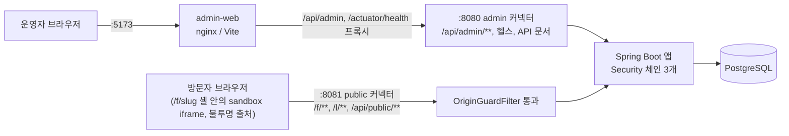

# 리드마그넷 CRM 운영 시스템 개요

제출물을 읽는 사람을 위한 문서다. 실행·테스트 방법은 [README](../README.md), 계획과 결정 이유는 [PLAN](PLAN.md)과 [ADR](adr/README.md), API는 [docs/api/openapi.yaml](api/openapi.yaml)에 있다.

## 1. 무엇을 만들었나

운영자가 AI로 만든 단일 HTML 폼을 등록하면, 그 HTML로 캠페인의 공개 신청 폼을 만들고 인스타그램·X·유튜브·스레드용 배포 링크를 발급한다. 방문자는 공개 폼에서 신청하고, 신청은 CRM 명단(PostgreSQL)에 쌓인다. 운영자는 캠페인별, 채널별로 방문·방문자·신청·전환 방문자·전환율을 본다. 이 시스템을 크리에이터 트래픽을 리드로 바꾸고 그 리드가 어느 채널에서 왔는지 증명하는 내부 매출 인프라로 이해했다. CRM이라 보안을 기능이 아니라 구조로 다뤘다. 출처(포트)와 필터 체인으로 영역을 나눴고 업로드 HTML은 sandbox iframe으로 권한을 0으로 만들었다.

## 2. 아키텍처

앱은 하나(Spring Boot)이고 Tomcat 커넥터가 두 개다(ADR [0010](adr/0010-single-app-two-ports.md)).

- `OriginGuardFilter`가 Security 앞에서 포트와 경로가 맞지 않는 요청을 404로 막는다. Security 체인은 admin(Bearer JWT), public(permitAll, 인증 헤더 무시), 기본(헬스·문서 외 denyAll) 세 개다(ADR [0003](adr/0003-auth.md)).
- 관리자 화면은 브라우저 입장에서 admin-web 출처 하나만 보므로 refresh 쿠키(SameSite=Strict, Path=/api/admin/auth)가 그대로 동작한다.

## 3. 요청 흐름: 링크 → 방문 → 신청 → 지표

1. 운영자가 템플릿을 업로드하고(폼 계약 검사, 필드 추출, ADR [0004](adr/0004-html-form-contract.md)) 캠페인과 폼을 만들어 게시한다(ADR [0013](adr/0013-campaign-form-status.md)). 채널별 배포 링크를 만든다.
2. 방문자가 `/l/{code}`를 열면 방문자 쿠키(`lm_vid`)만 받고 `/f/{slug}?lm={code}`로 302된다. 이 단계에서는 방문을 기록하지 않는다(ADR [0006](adr/0006-channel-attribution.md)).
3. `/f/{slug}` 로드 1회가 방문 1건이다. 페이지는 고정 셸이고 래퍼 스크립트가 `/api/public/forms/{slug}`로 HTML을 받아 sandbox iframe에 넣는다(ADR [0002](adr/0002-html-isolation.md)).
4. iframe은 입력을 postMessage로 래퍼에 넘기고, 래퍼가 검증한 뒤 `POST /api/public/forms/{slug}/submissions`로 보낸다. 서버가 동의와 필드 설정을 다시 검증하고 중복을 막는다(ADR [0007](adr/0007-duplicate-submission.md), [0008](adr/0008-lead-data-storage.md)). 신청은 방문 때 정해진 채널로 귀속된다.
5. 운영자가 캠페인 통계와 채널별 통계, 명단을 조회한다.

## 4. 보안 설계 요약

| 위협 | 대응 | 증명하는 테스트 |
|---|---|---|
| 미인증으로 관리자 API 접근, 만료·위조 토큰 | admin 체인 Bearer JWT, 서명·exp·iss·aud 검증 | `AdminResourceServerTest`, `AuthApiTest` |
| refresh token 탈취·재사용 | 사용마다 교체, 재사용 시 패밀리 전체 폐기, DB에는 해시만 저장 | `AuthApiTest`, `RefreshTokenTest` |
| 공개 출처에서 관리자 API 접근 | public 포트는 공개 경로만, 나머지 404 (OriginGuardFilter) | `PublicOriginIsolationTest`, `IsolationScenarioTest` |
| 다른 출처의 CORS 요청 | 관리자 API CORS는 `ADMIN_ORIGIN`만 허용 | `AdminCorsTest`, `PublicOriginIsolationTest` |
| 업로드 HTML이 관리자 자격 증명에 접근 | sandbox iframe(`allow-same-origin` 금지)로만 렌더링, 쿠키·DOM 접근 불가 | `PublicOriginIsolationTest`(`래퍼_셸은_allow_same_origin_없이_샌드박스_iframe만_쓴다`), `IsolationScenarioTest`, `TemplateDetail.test.tsx`(admin-web 미리보기) |
| 업로드 HTML이 방문자 입력을 외부로 전송 | CSP `default-src 'none'`, `connect-src 'self'`, `form-action 'none'`, 이미지·스타일·폰트는 `'self'`/`data:`만 (ADR 0002 변경 기록) | `PublicOriginIsolationTest`(CSP 값을 정확히 비교) |
| 래퍼 우회 제출(sandbox에서 직접 호출) | 서버가 신뢰 경계: JSON만, `Origin: null`은 403, 동의·필드 검증 | `LeadSubmissionApiTest`, `SubmissionValidatorTest` |
| NUL·제어 문자 입력 | 422로 거부(500·로그 오염 방지) | `TextInputTest`, `LeadSubmissionApiTest` |
| 중복 신청, 전화번호가 DB 오류 로그에 실리는 문제 | 부분 유니크 인덱스 + `ON CONFLICT DO NOTHING`, 409 | `LeadSubmissionApiTest`, `SchemaMigrationTest` |
| 개인정보가 로그에 남음 | `PiiMasker`, 원문 미기록 | `PiiMaskerTest`, `LeadSubmissionApiTest`(로그 캡처) |
| 클릭재킹, `<base>` 주입 | `frame-ancestors 'none'`, `X-Frame-Options: DENY`, `base-uri 'none'` | `PublicOriginIsolationTest` |
| 에러 응답으로 정보 노출 | 404/ProblemDetail 통일, 401·403도 같은 형식 | `ProblemDetailContractTest`, `ProblemDetailsTest` |
| 관리자 화면이 업로드 HTML 미리보기에서 오염 | 미리보기도 같은 sandbox 컴포넌트 하나로만, CSP를 admin-web에도 적용 | `csp.test.ts`, `TemplateDetail.test.tsx`(admin-web) |

## 5. 지표 정의

방문은 `/f/{slug}` 로드 1회, 방문자는 `visitor_id`의 고유 수, 신청은 `leads` 행 수, 전환율은 방문과 신청 양쪽에 있는 방문자 수 ÷ 방문자 수(분모 0이면 0)다. 날짜는 Asia/Seoul 기준이고 채널별 전환은 같은 채널 안의 교집합이다. 정의 전문과 알려진 한계는 ADR [0005](adr/0005-metrics-definition.md)에 있고 `StatsQuery` SQL 주석에 그대로 인용되어 있다.

## 6. 모호한 요구와 가정

| 모호한 지점 | 가정 | ADR |
|---|---|---|
| 업로드 HTML을 어떻게 안전하게 보여줄까 | sandbox iframe + postMessage + CSP, 스크립트는 지우지 않음 | [0002](adr/0002-html-isolation.md) |
| 인증 방식과 토큰 수명 | 자체 발급 JWT 15분 + refresh 14일 교체·재사용 감지 | [0003](adr/0003-auth.md) |
| "단일 HTML 폼"의 최소 계약 | form 1개, 연락처(phone 또는 email) 필수, file·password 금지 | [0004](adr/0004-html-form-contract.md) |
| 전환율의 정의 | 방문자 교집합 기반, 서울 시간대 | [0005](adr/0005-metrics-definition.md) |
| 채널 귀속 | `lm` 코드로 방문 시 귀속, 직접 접근은 `direct` | [0006](adr/0006-channel-attribution.md) |
| 중복 신청 | 같은 폼의 같은 phone/email은 409 | [0007](adr/0007-duplicate-submission.md) |
| 신청 데이터 저장 | 연락처 컬럼 + 나머지는 jsonb | [0008](adr/0008-lead-data-storage.md) |
| 운영자 계정은 어떻게 만드나 | 기동 시 환경 변수 시드 | [0009](adr/0009-operator-seed.md) |
| 출처 분리 방식 | 앱 하나, 포트 두 개 | [0010](adr/0010-single-app-two-ports.md) |
| 관리자 UI 구성 | React SPA, 메모리 토큰, URL 쿼리 상태 | [0011](adr/0011-admin-ui.md) |
| 폼·캠페인 상태 | draft → published → closed, 게시 후 필드 고정 | [0013](adr/0013-campaign-form-status.md) |
| 기술 스택·브랜치 전략 | [0001](adr/0001-tech-stack.md), [0012](adr/0012-branch-environment.md) | |

## 7. 테스트 전략과 숫자

모든 기능에 성공·실패 케이스를 함께 둔다. backend는 Testcontainers의 실제 PostgreSQL(`postgres:17-alpine`)로 돌리고 H2를 쓰지 않는다.

| 대상 | 명령 | 결과 |
|---|---|---|
| backend | `cd backend && ./gradlew test` | 44개 테스트 클래스, 360개 테스트 통과(실패 0, verify 모드에서 export 쓰기 테스트 1건은 건너뜀) |
| admin-web | `cd admin-web && npm test` | 12개 파일, 78개 테스트 통과 |

- 도메인 규칙은 Spring 없는 단위 테스트(`FormContractParserTest`, `SubmissionValidatorTest`, `MetricsTest` 등), API는 `@IntegrationTest` + RestAssured다.
- 시나리오 테스트(`HappyPathScenarioTest`, `FailureScenarioTest`, `IsolationScenarioTest`)는 두 포트를 오가며 로그인 → 업로드 → 배포 → 방문 → 신청 → 지표를 실제 HTTP로 잇고, 지표는 손계산 표와 정확히 비교한다.
- 이 저장소의 자동 테스트는 서버가 내려주는 셸·CSP·헤더까지만 검증하고, 브라우저 안의 iframe·postMessage 동작은 포함하지 않는다. 브라우저 E2E는 Playwright로 별도 수행하고 결과를 리포트로 남긴다.
- `OpenApiExportTest`가 `docs/api/openapi.yaml`을 앱에서 내보내고, CI는 `-Dopenapi.verify=true`로 커밋된 파일이 최신인지 확인한다. 문서에는 admin 계열과 공개 경로가 함께 들어 있고 공개 경로는 오퍼레이션 단위로 public 출처(:8081)를 server로 가리킨다. 파일은 하나다.

## 8. AI 활용 방식

AI(Claude Code)로 구현하되 사람이 정한 규칙 안에서 움직이도록 통제했다.

1. 계획: 먼저 [PLAN](PLAN.md)에 해석, 결정과 이유, 이슈 순서를 정하고 이슈별 plan brief를 만들었다.
2. 가드레일: [CLAUDE.md](../CLAUDE.md)의 보안 불변식(출처 격리, sandbox, 토큰 보관, 개인정보 로그 금지)과 작업·코드 규칙을 AI가 어기지 못하는 기준으로 두었다.
3. 구현: 이슈마다 TDD로 일하는 implementer 서브에이전트가 실패 테스트 → 구현 순서로 만들었다.
4. 리뷰: 이슈마다 독립된 reviewer 서브에이전트가 따로 검토했고, 지적 사항은 수정 라운드를 거쳐 반영했다.
5. 최종 검토: 백엔드 전체를 한 번에 본 리뷰에서 릴리스 차단 이슈 3건이 나와 고쳤다.
   - NUL 문자 입력이 500이 되고 오류 로그에 다른 개인정보까지 실리는 문제 → 422로 거부
   - `value` 없는 체크박스·라디오 때문에 신청을 하나도 받지 못하는 폼 → 브라우저 기본값 `on`을 받음
   - CSP가 이미지·폰트·스타일의 외부 `https:`를 허용해 입력이 GET URL로 새는 경로 → 허용 제거(ADR 0002 변경 기록)

PR(저장소 https://github.com/kimcno3/lead-magnet-crm):

| PR | 내용 |
|---|---|
| [#20](https://github.com/kimcno3/lead-magnet-crm/pull/20) | 저장소 골격과 로컬 실행 환경 |
| [#21](https://github.com/kimcno3/lead-magnet-crm/pull/21) | Flyway 스키마, 프로필, 운영자 시드 |
| [#22](https://github.com/kimcno3/lead-magnet-crm/pull/22) | 인증(JWT, refresh 교체·재사용 감지) |
| [#23](https://github.com/kimcno3/lead-magnet-crm/pull/23) | HTML 템플릿 업로드와 폼 계약 |
| [#24](https://github.com/kimcno3/lead-magnet-crm/pull/24) | 캠페인·폼 |
| [#25](https://github.com/kimcno3/lead-magnet-crm/pull/25) | 배포 링크 |
| [#26](https://github.com/kimcno3/lead-magnet-crm/pull/26) | 공개 출처 격리와 방문 추적 |
| [#27](https://github.com/kimcno3/lead-magnet-crm/pull/27) | 신청 접수와 명단 |
| [#28](https://github.com/kimcno3/lead-magnet-crm/pull/28) | 성과 지표 |
| [#29](https://github.com/kimcno3/lead-magnet-crm/pull/29) | 성공·실패·격리 시나리오 테스트 |
| [#31](https://github.com/kimcno3/lead-magnet-crm/pull/31) | 최종 리뷰 반영 |
| [#32](https://github.com/kimcno3/lead-magnet-crm/pull/32) | 관리자 화면(admin-web) |
| 이 PR | 문서와 릴리스 |

## 9. 범위 밖과 로드맵

실제 AI 연동, 외부 CRM·문자·알림톡·광고 연동, 범용 폼 빌더, 결제는 범위 밖이다. 배포(Render·Neon), dev·prod 프로필, Authorization Server, 로그인 시도 제한, refresh 절대 수명, 웹훅, 멀티모듈 분리는 [ROADMAP](ROADMAP.md)에 있다. v0.2.0 extras 후보(크리에이터별 성과, 개인정보 암호화, 감사 로그, 템플릿 점검 등)는 [PLAN](PLAN.md) 6.2절에 있다.
